<p align="center"></p>

<h1 align="center">In-House AI</h1>

<p align="center"><b>Private AI for your documents.</b><br>Runs on your hardware. Nothing leaves it.</p>

<p align="center">
  <a href="https://inhouse-ai.razajahangir.dev">Website</a> ·
  <a href="docs/setup.md">Setup guide</a> ·
  <a href="docs/benchmarks.md">Benchmarks</a> ·
  <a href="docs/customize.md">Customize</a>
</p>

<p align="center"></p>

## Your own ChatGPT-style assistant

Multi-user chat, local language models, and answers from your own documents, with citations.
One Docker Compose file, built on established open-source projects. No AI provider ever sees
your prompts or your files.

```bash
curl -fsSL https://inhouse-ai.razajahangir.dev/install.sh | bash
```

Needs Docker with Compose v2, git and openssl. The script asks how you want to reach it
(Tailscale, Cloudflare or this machine only) and which model server to use, then starts the
stack. Open `http://localhost:3000` and create the first account; it becomes the admin.
Prefer to do it by hand? See the [setup guide](docs/setup.md).

## How a question is answered

<p align="center"></p>

## Private by design

- **Local inference.** The model, embeddings and document search all run on your machine.
- **Local storage.** Users, chats and vectors live in your own Postgres. Weights stay on your disk.
- **Closed doors.** No inbound ports. Remote access is by Tailscale or an identity-checked Cloudflare Tunnel, both optional.
- **Isolated knowledge.** Every user's documents are separate from everyone else's.
- **Plain logging.** LiteLLM records each call's model, tokens and timing in your own Postgres. Prompts and answers are not stored unless you switch that on. [Tracing with LiteLLM](docs/customize.md#tracing-with-litellm)

## Scales with you

<p align="center"></p>

Start on a CPU-only laptop. Move to a GPU server by changing one line in the gateway. Nothing
else changes. [Measure your own hardware](docs/benchmarks.md).

## Built from

| | |
|---|---|
| **Open WebUI** | Chat, users, knowledge bases, built-in RAG |
| **LiteLLM** | One gateway, swappable model backends |
| **Ollama** | Local models, replaced by vLLM on larger hardware |
| **Postgres + pgvector** | App data and vector search |
| **Tailscale · Cloudflare** | Private remote access, your choice |

## Learn more

[Setup guide](docs/setup.md) · [Benchmarks](docs/benchmarks.md) · [Customize and scale](docs/customize.md) · [Contributing](CONTRIBUTING.md) · [Security](SECURITY.md)

Want it deployed on your hardware or tailored to your tools?
[LinkedIn](https://www.linkedin.com/in/raza-jahangir) · [Upwork](https://www.upwork.com/freelancers/developerraza)

<sub>MIT licensed. Each component keeps its own licence. See [third-party software](docs/customize.md#third-party-software).</sub>
