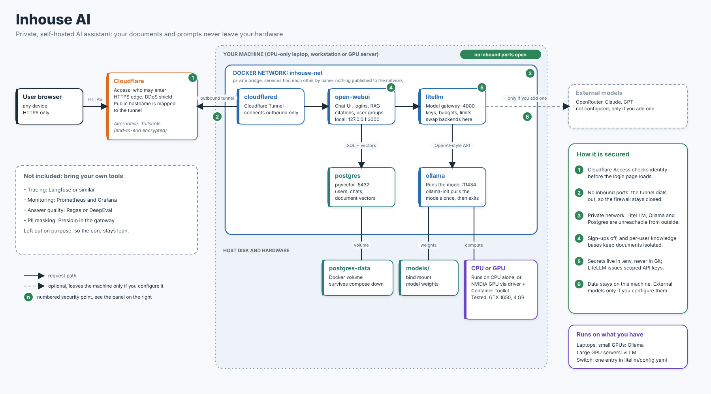

# Inhouse AI

**Your own ChatGPT-style assistant, running on your hardware, where your documents never
leave your control.**

Inhouse AI is a ready-to-run, self-hosted AI stack: multi-user chat, local language models,
and question-answering over your own documents with citations. One Docker Compose file, built
entirely on established open-source projects. No AI provider sees your prompts or your files.

## Who it's for

Anyone who wants the benefits of AI but can't, or won't, paste their data into a public
chatbot:

- **Small teams and businesses** with contracts, finances, HR files or client records.
- **Consultants, agencies and freelancers** handling clients' confidential material.
- **Regulated work:** legal, healthcare, finance, where data location matters.
- **Developers and tinkerers** who want a private AI they fully understand and control.

## What stays private

- **Your prompts and documents are processed on your own machine.** The language model, the
  embeddings and the document search all run locally. No external AI provider is configured.
  Adding one is a deliberate change to `litellm/config.yaml`, never a default.
- **Your data is stored on your own disk:** users, chats and document vectors live in a local
  Postgres database; model weights in a local folder.
- **Nothing listens on your network.** Internal services talk over a private Docker network,
  and no inbound port is opened on your firewall.
- **Access is identity-checked** before anyone even sees the login page, and every user's
  knowledge bases are isolated from the others.

**Be aware of one trade-off.** For remote access, the default uses a Cloudflare Tunnel, which
is convenient but means Cloudflare decrypts traffic at its edge on its way to you. For truly
sensitive data, use **Tailscale** instead (end-to-end encrypted; it only sees metadata), or
keep the stack on your local network only. See [Swap a component](#swap-a-component).

The only other outbound connections are downloading container images and models during
setup, plus the tunnel if you use it.

## Runs on what you have

From a CPU-only laptop to a small GPU, a workstation, a DGX Spark or a multi-GPU server. Start
small with Ollama, then point the gateway at a server backend such as vLLM as your hardware
and users grow. Nothing else in the stack changes. A [benchmark method](#benchmarking-how-to-measure-your-own-hardware)
tells you what your own hardware can actually do.

## How it's built

| Service      | Image                         | Role                                                  |
|--------------|-------------------------------|-------------------------------------------------------|
| `open-webui` | ghcr.io/open-webui/open-webui | Multi-user chat UI, auth, knowledge bases, built-in RAG |
| `litellm`    | ghcr.io/berriai/litellm       | Model gateway: one API, swappable backends, rate limits |
| `ollama`     | ollama/ollama                 | Local model server. vLLM replaces it on bigger hardware |
| `postgres`   | pgvector/pgvector:pg16        | App database + vector store for RAG                   |
| `cloudflared`| cloudflare/cloudflared        | Outbound-only tunnel: the only way in from outside    |
| `ollama-init`| ollama/ollama                 | One-shot job that downloads the models, then exits    |



## Contents

- [Security model](#security-model)
- [Setup (Steps 1–10)](#step-1-install-docker-engine-ubuntu)
- [Benchmarking: how to measure your own hardware](#benchmarking-how-to-measure-your-own-hardware)
- [Swap a component](#swap-a-component)
- [Scaling up: bigger GPUs and servers](#scaling-up-bigger-gpus-and-servers)
- [Scope](#scope-whats-deliberately-not-included) · [Need help?](#need-help)
- [Useful commands](#useful-commands) · [Troubleshooting](#troubleshooting)

## Security model

- Every service sits on the private Docker network `inhouse-net` and talks by service name.
- No port is published to the network. `cloudflared` makes an outbound connection to
  Cloudflare, so the firewall can keep every inbound port closed.
- Cloudflare Access checks identity before anyone even sees the login page.
- Open WebUI is also bound to `127.0.0.1:3000` for local access. Remove that binding if you
  only want access through the tunnel.
- Keep secrets only in `.env`; `.gitignore` excludes it. Verify with `git status` before
  sharing the repository, because ignore rules do not remove a file that was already tracked.
- Sign-ups are turned off after the first (admin) account, so only the admin adds users.

---

## Step 1: Install Docker Engine (Ubuntu)

Use Docker's official apt repository, not the Snap package or Docker Desktop.

```bash
sudo apt-get update
sudo apt-get install -y ca-certificates curl
sudo install -m 0755 -d /etc/apt/keyrings
sudo curl -fsSL https://download.docker.com/linux/ubuntu/gpg -o /etc/apt/keyrings/docker.asc
sudo chmod a+r /etc/apt/keyrings/docker.asc
echo "deb [arch=$(dpkg --print-architecture) signed-by=/etc/apt/keyrings/docker.asc] \
https://download.docker.com/linux/ubuntu $(. /etc/os-release && echo "$VERSION_CODENAME") stable" \
  | sudo tee /etc/apt/sources.list.d/docker.list > /dev/null
sudo apt-get update
sudo apt-get install -y docker-ce docker-ce-cli containerd.io docker-buildx-plugin docker-compose-plugin

sudo usermod -aG docker $USER
```

Log out and back in, then check:

```bash
docker run --rm hello-world
docker compose version
```

### GPU access (NVIDIA only, optional)

Skip this on a CPU-only machine, and remove the `deploy:` block from the `ollama` service.

1. Install the NVIDIA driver and check it works: `nvidia-smi`.
2. Install the [NVIDIA Container Toolkit](https://docs.nvidia.com/datacenter/cloud-native/container-toolkit/latest/install-guide.html),
   then register it with Docker:

   ```bash
   sudo nvidia-ctk runtime configure --runtime=docker
   sudo systemctl restart docker
   ```

3. The `ollama` service requests the GPU with:

   ```yaml
   deploy:
     resources:
       reservations:
         devices:
           - driver: nvidia
             count: all
             capabilities: [gpu]
   ```

   This is a reservation: if the GPU isn't available, Compose refuses to start the container
   rather than silently falling back to the CPU.

## Step 2: Get the project

```bash
git clone https://github.com/<your-username>/inhouse-ai.git
cd inhouse-ai
```

The layout:

```
inhouse-ai/
├── docker-compose.yaml     # all services, network and volumes
├── .env.example            # safe template; copy to .env
├── .gitignore              # excludes .env and models/
├── README.md
├── litellm/
│   └── config.yaml         # maps model names to backends
├── benchmarks/
│   ├── bench.py            # optional automated benchmark
│   └── prompts/            # the benchmark prompts
└── models/                 # downloaded model weights (created on first run, not in Git)
```

## Step 3: Fill in the secrets

```bash
cp .env.example .env
openssl rand -hex 32   # run once for each secret below
```

Edit `.env`:

- `WEBUI_SECRET_KEY`: a random value.
- `POSTGRES_USER`, `POSTGRES_DB`: names with underscores, not hyphens (e.g. `inhouse_ai_user`, `inhouse_ai_db`).
- `POSTGRES_PASSWORD`: a random value.
- `LITELLM_MASTER_KEY`: a random value **starting with `sk-`**, e.g. `sk-<random>`.
- `CHAT_MODEL` / `EMBED_MODEL`: e.g. `qwen3:4b-instruct` / `nomic-embed-text`. The chat model
  name must match the one in `litellm/config.yaml`.
- `CLOUDFLARE_TUNNEL_TOKEN`: filled in during Step 4.

Check the file is ignored by Git:

```bash
git status   # .env must NOT appear
```

## Step 4: Create the Cloudflare Tunnel

You need a domain whose DNS is managed by Cloudflare. (Prefer a fully private network?
See [Swap a component](#swap-a-component) for Tailscale.)

1. Cloudflare dashboard → **Zero Trust → Networks → Tunnels → Create a tunnel**.
2. Choose **Cloudflared**, name it `inhouse-ai`, and pick **Docker** as the environment.
3. Cloudflare shows a `docker run ... --token <long-token>` command. Copy **only the token**
   (it starts with `eyJ`) into `CLOUDFLARE_TUNNEL_TOKEN` in `.env`. Don't run that command.
4. Add a **public hostname**:
   - Subdomain: `chat` / Domain: `yourdomain.com`
   - Service type: `HTTP`, URL: `open-webui:8080`

   Use the container name, not `localhost`. Inside the tunnel container, `localhost` is the
   tunnel itself.

## Step 5: Protect it with Cloudflare Access

Without this step, the login page is public to anyone who finds the URL.

1. **Zero Trust → Access → Applications → Add an application → Self-hosted**.
2. Application domain: `chat.yourdomain.com`.
3. Add a policy: **Action** Allow, **Include** Emails → your email (or your team's email domain).
4. Login method: One-time PIN is enough to start.

## Step 6: Start the stack

```bash
docker compose up -d
docker compose logs -f ollama-init
```

Wait until both models have downloaded (about 3 GB) and `ollama-init` exits. Then:

```bash
docker compose ps
```

Everything should show `running` (and `healthy` where a healthcheck exists), except
`ollama-init`, which shows `exited (0)`.

## Step 7: Verify each layer

**Tunnel:**

```bash
docker compose logs cloudflared | grep -i "registered"
```

You should see four registered tunnel connections.

**Gateway sees the models:**

```bash
KEY=$(grep '^LITELLM_MASTER_KEY=' .env | cut -d= -f2)
docker compose exec open-webui curl -s http://litellm:4000/v1/models -H "Authorization: Bearer $KEY"
```

You should see `local-chat` and `local-embed`.

**A model answers through the gateway:**

```bash
docker compose exec open-webui curl -s http://litellm:4000/v1/chat/completions \
  -H "Authorization: Bearer $KEY" -H "Content-Type: application/json" \
  -d '{"model":"local-chat","messages":[{"role":"user","content":"Say hello in five words."}]}'
```

The first call can take a minute on CPU while the model loads.

**The model is on the GPU (if you have one):**

```bash
docker compose exec ollama ollama ps
```

The `PROCESSOR` column shows the CPU/GPU split, e.g. `22%/78% CPU/GPU` when the model doesn't
quite fit in VRAM, or `100% GPU` when it does.

**Nothing is exposed:**

```bash
sudo ss -tlnp | grep -E '3000|4000|5432|11434'
```

Only `127.0.0.1:3000` should appear. Nothing should listen on `0.0.0.0`.

## Step 8: First login and lock down sign-ups

1. Open `https://chat.yourdomain.com`, or `http://localhost:3000` locally.
2. Create the first account. It becomes the **admin**.
3. In `docker-compose.yaml`, set `ENABLE_SIGNUP: "false"`, then:

   ```bash
   docker compose up -d
   ```

From now on, only the admin adds users (**Admin Panel → Users**).

## Step 9: Set up RAG

1. **Workspace → Knowledge → Create**, e.g. "Company Policies".
2. Upload a few real PDFs or Word documents.
3. In a chat, type `#` and pick the knowledge base, then ask a question about the documents.
4. The answer should include clickable citations pointing back to the source.

On small GPUs, keep **Top K** at 3 (Admin Panel → Settings → Documents). Every retrieved chunk
makes the prompt longer, and long prompts are the slow part on modest hardware.

**Data isolation check:** create a second user who isn't in the knowledge base's group, log in
as them, and confirm they can't see or query it.

## Step 10: Walk through it end to end

A good order for showing the stack to someone (about 10 minutes):

1. Architecture: `docker compose ps` and this README's diagram.
2. Security: closed ports (`ss -tlnp`), the Cloudflare Access login, `.env` not in Git.
3. Chat with a local model through the tunnel.
4. RAG: upload a document, ask a question, show the citations.
5. Data isolation: switch to the second user.
6. The upgrade path: show the vLLM swap below and explain that only the gateway config changes.
7. Reproducibility: `docker compose down && docker compose up -d` (volumes keep the data).

Send one prompt first to warm up the model, and close heavy apps to free RAM.

---

## Benchmarking: how to measure your own hardware

The numbers that decide how the stack feels are the model's speed on your hardware. This
section measures exactly that, with nothing else in the way: no Open WebUI, no LiteLLM, no
retrieval. Run it on any supported host, from a CPU-only laptop or small GPU to a workstation,
DGX Spark, or multi-GPU server.

### What is measured

Ollama's `--verbose` output prints these after every answer:

| Ollama output | Meaning | Why it matters |
|---|---|---|
| `prompt eval count` | Tokens the model had to read (your text + chat template + any history) | RAG adds retrieved chunks here, so it can reach thousands |
| `prompt eval cached` | Tokens reused from Ollama's cache instead of read again | ~3 is normal (the chat template). A big number means the run is invalid |
| `prompt eval duration` | Time spent reading the prompt | Roughly the **wait before the first word** |
| `prompt eval rate` | Reading speed, tokens/s | Decides the wait on long (RAG) prompts |
| `eval count` / `eval rate` | Tokens written / writing speed, tokens/s | How fast the answer streams |
| `load duration` | Time to load the model | Should be milliseconds once warm; seconds means a cold start |

### Method

1. **Record your setup:** on NVIDIA systems, capture `nvidia-smi` (driver, CUDA); on CPU-only
   systems, record the CPU model. Also record `docker compose exec ollama ollama --version`,
   `docker compose exec ollama ollama show <model>` (parameters, quantization), and the context
   length (`grep CONTEXT docker-compose.yaml`).
2. **Fix the conditions:** close competing workloads and avoid thermal throttling. On a
   laptop, keep it plugged in and on a hard surface. For NVIDIA GPUs, monitor with
   `watch -n 1 nvidia-smi`.
3. **Start a session and lock the settings** (they last only for this session):

   ```bash
   docker compose exec ollama ollama run qwen3:4b-instruct --verbose
   ```
   ```
   /set parameter temperature 0
   /set parameter num_predict 300
   ```

4. **Warm up:** send `hi` and ignore the numbers.
5. **Make every run fresh:**
   - Type `/clear` before each run, so no chat history is re-sent.
   - Start each prompt with a different first word (`Apple:`, `Banana:`, `Cherry:` …), so
     Ollama's prompt cache can't skip the reading.
   - Check `prompt eval cached` stays around 3. If it's larger, discard and repeat the run.
6. **Run three prompt sizes**, three to five times each (starter prompts are in `benchmarks/prompts/`):
   - **Short:** `What is Docker in one sentence?`
   - **Medium:** `Explain how a reverse proxy works and when you'd use one, in about 200 words.`
   - **Long (RAG-sized):** the ~2,150-word document in `benchmarks/prompts/long.txt`
     (~3,500 tokens), wrapped in `"""` so Ollama accepts multiple lines. It starts with
     `Summarise the main points of this document.`
7. **Watch the hardware** during a long run (VRAM, GPU-Util, temperature, power), then after
   `/bye` run `docker compose exec ollama ollama ps` for the CPU/GPU split.
8. **Average** each prompt's runs. If runs differ by more than a few percent, something else
   is competing for the machine; fix that and repeat.

**Prefer it automated?** `benchmarks/bench.py` benchmarks through Ollama's API, prints a
Markdown results table, and saves a JSON results file under `benchmarks/results/`. It uses
only the Python standard library and connects over the private Docker network:

```bash
docker run --rm --network inhouse-net \
  -v "$PWD/benchmarks:/bench" -w /bench python:3.12-slim \
  python bench.py --model qwen3:4b-instruct --runs 3
```

The table below shows example results. Follow [CONTRIBUTING.md](./CONTRIBUTING.md) to add a
benchmark row for your hardware.

### Tested on

| | |
|---|---|
| Machine | HP Victus laptop, Ubuntu |
| GPU | NVIDIA GeForce GTX 1650, 4 GB VRAM (driver 595.99.02, CUDA 13.2) |
| RAM | 24 GB |
| Chat model | `qwen3:4b-instruct` (4.0B, Q4_K_M, Apache 2.0) |
| Embedding model | `nomic-embed-text` |
| Runtime | Ollama x.y.z (llama.cpp), context 8,192 tokens |

The stack also runs on CPU only (ThinkPad T14s, 16 GB RAM); it is just slower on long prompts.

### Example results: HP Victus (GTX 1650, 4 GB)

Settings: `qwen3:4b-instruct`, Q4_K_M, context 8,192, temperature 0, max 300 output tokens,
warm model, no chat history. 3.4 GB loaded, 22% CPU / 78% GPU (2.6 GB in VRAM).

| Prompt | Prompt tokens | Time to first token | Reading speed | Writing speed | Total time |
|---|---|---|---|---|---|
| Short | 26 | 0.30 s | n/a* | 28.5 ± 0.4 tok/s | 1.1 s |
| Medium | 41 | 0.42 s | 103 tok/s | 26.7 ± 0.9 tok/s | 9.2 s |
| Long (RAG-sized) | 3,576 | 30.7 s | 118 tok/s | 11.9 ± 0.3 tok/s | 56 s |

Measured with `benchmarks/bench.py`: two separate sessions of 3 runs each (6 runs per prompt),
warm-up discarded. Manual runs with `ollama run --verbose` agreed within ~5%.

\*Too few tokens to time reliably.

GPU at 99–100% utilisation, 48–49 °C, 28 W of 50 W, no throttling.

**What it shows:** short chats feel instant, but a RAG-sized prompt of ~3,500 tokens means a
~30-second wait before the first word, and generation slows from ~28 to ~12 tok/s (and to ~10
on very long answers, because each new token looks back over everything before it). On small
hardware, **reading long prompts is the bottleneck**, which is why Top K matters for RAG and
why bigger GPUs, workstations or unified-memory machines change the experience.

Ran it on your hardware? Open a pull request adding a row: machine, GPU/VRAM, RAM, model,
quantization, context length, and the five numbers above.

### Baseline vs end-to-end

These numbers are the **model-on-hardware baseline**. A real RAG question in Open WebUI adds
embedding the question, a pgvector search and the gateway hop, so the wait a user sees is a
little longer. LiteLLM itself adds only milliseconds.

---

## Swap a component

One opinionated stack that works, with clear exits:

| Component | Default | Common alternative | What changes |
|---|---|---|---|
| Model server | Ollama | vLLM (big GPUs, many users) | Replace the service; point `litellm/config.yaml` at it |
| Chat model | `qwen3:4b-instruct` | `llama3.2:3b` (fits fully in 4 GB), `gemma3:4b`, `phi4-mini`, larger Qwen on big hardware | `CHAT_MODEL` in `.env` and `litellm/config.yaml` |
| Remote access | Cloudflare Tunnel + Access | Tailscale (end-to-end encrypted, private network only) | Remove `cloudflared`; run `tailscale serve` on the host |
| Hardware | NVIDIA GPU | CPU only | Remove the `deploy:` block from `ollama` |
| Vector store | pgvector in Postgres | Qdrant, Chroma | Open WebUI's `VECTOR_DB` settings |

Trade-off to know: Cloudflare decrypts traffic at its edge; Tailscale only sees metadata.
For confidential data, decide which you're comfortable with.

## Scaling up: bigger GPUs and servers

1. On a larger GPU server, replace the `ollama` and `ollama-init` services with a vLLM
   container supported by that server, with accelerator access and model storage mounted
   read-only from the host. A workstation, multi-GPU server, or NVIDIA DGX Spark are all
   possible targets; select a backend and configuration suited to the hardware.
2. In `litellm/config.yaml`, change the model entry:

   ```yaml
   - model_name: local-chat
     litellm_params:
       model: hosted_vllm/<model-name>
       api_base: http://vllm:8000/v1
   ```

   Open WebUI doesn't change at all. It still asks for `local-chat`.
3. Pin every image to an exact version tag (no `latest` or `main`).
4. Remove the `127.0.0.1:3000` port binding from `open-webui`.
5. Check the target architecture before deploying. For example, the DGX Spark is ARM64;
   verify that any custom image you add supports the target system.
6. Benchmark with the method above, then load-test with `vllm bench serve` at increasing
   numbers of concurrent users.

Hardware tradeoffs vary by system. A laptop GPU has limited dedicated VRAM, and work that
doesn't fit may spill to CPU memory over PCIe. The DGX Spark is one example of a system with
128 GB of unified memory shared by CPU and GPU, allowing larger models to remain in memory
accessible to the accelerator. Multi-GPU servers offer another scaling path through
additional accelerator memory and parallel compute.

## Scope: what's deliberately not included

Inhouse AI is the core you need to run a private assistant, and nothing more. Observability,
evaluation and data-protection layers are left out on purpose: teams that self-host usually
have their own preferences, and every extra layer is more to install, secure and maintain.

Good places to extend it, with your tools of choice:

- **Tracing and monitoring:** LiteLLM supports callbacks to tools such as Langfuse; the
  model server and GPU can be monitored with Prometheus and Grafana.
- **Answer-quality evaluation:** a test set of questions scored with a framework such as
  Ragas or DeepEval.
- **PII masking:** guardrails in the gateway, for example with Presidio.

## Need help?

Want Inhouse AI deployed on your own hardware, adapted to your documents and tools, or
extended with monitoring and evaluation? Get in touch:
[LinkedIn](https://www.linkedin.com/in/raza-jahangir) ·
[Upwork](https://www.upwork.com/freelancers/developerraza)

## Third-party software

Inhouse AI combines independently licensed software and models. Each component remains under
its own licence; users must review and comply with the applicable licences and terms:

- [Open WebUI](https://github.com/open-webui/open-webui): Open WebUI License (includes
  conditions on altering or removing Open WebUI branding)
- [LiteLLM](https://github.com/BerriAI/litellm): MIT for core components; other components
  may have separate terms
- [Ollama](https://github.com/ollama/ollama): MIT
- [pgvector](https://github.com/pgvector/pgvector): PostgreSQL License
- [cloudflared](https://github.com/cloudflare/cloudflared): Apache License 2.0
- Default chat model, Qwen3 `qwen3:4b-instruct`: Apache License 2.0

These are the upstream projects' stated licences. Check the exact versions and model
artifacts you download; their licence notices govern your use.

## Useful commands

```bash
docker compose ps                              # status
docker compose logs -f <service>               # follow logs
docker compose restart <service>               # restart one service (e.g. after editing litellm/config.yaml)
docker compose up -d                           # apply changes to .env or docker-compose.yaml
docker compose exec ollama ollama ps           # is the model on GPU or CPU?
docker compose exec ollama ollama list         # downloaded models
watch -n 1 nvidia-smi                          # live GPU use
docker compose down                            # stop (data kept in volumes)
docker compose down -v                         # stop AND delete all data — careful
docker compose pull && docker compose up -d    # update images
```

## Troubleshooting

| Symptom | Likely cause / fix |
|---|---|
| `permission denied` on the Docker socket | You're not in the `docker` group yet: `sudo usermod -aG docker $USER`, then log out and in. |
| Open WebUI says **"Backend Required"** or **"frontend only"** | Confirm `docker compose ps open-webui` shows the service running, then check `curl -i http://127.0.0.1:3000/api/config` returns `200`. Open `http://localhost:3000` locally, or make sure the Cloudflare hostname routes to `http://open-webui:8080`. If the API check returns `200` but the page still shows this message, hard-reload the page or clear site data for that hostname and try a private window; the browser may be using stale frontend assets or session data. If the check fails, inspect `docker compose logs --tail=100 open-webui`. |
| No models in the Open WebUI picker | `ollama-init` still running, or the LiteLLM key in `.env` doesn't start with `sk-`. Check `docker compose logs litellm`. |
| `model not found` | The model wasn't pulled, or `CHAT_MODEL` and `litellm/config.yaml` don't match. |
| Tunnel URL shows a 502 error | Hostname service URL isn't `http://open-webui:8080`, or Open WebUI is still starting. |
| `cloudflared` keeps restarting / "token is not valid" | Wrong or empty `CLOUDFLARE_TUNNEL_TOKEN`. Copy only the token (starts with `eyJ`), then `docker compose up -d --force-recreate cloudflared`. |
| Document upload fails | Embedding model not downloaded. Run `docker compose logs ollama-init`. |
| "prompt is too long" / context error with RAG | Raise `OLLAMA_CONTEXT_LENGTH` (e.g. 8192), lower Top K to 3, and turn off tools you don't need. |
| Replies show long "thinking" text | Use an instruct (non-thinking) model such as `qwen3:4b-instruct`. |
| Replies very slow | Check `ollama ps`: if mostly CPU, use a smaller model (`llama3.2:3b`, `qwen3:1.7b`) in both `.env` and `litellm/config.yaml`. Warm the model up first. |
| Open WebUI can't reach Postgres | Password changed after the first start. Postgres keeps the old one in its volume. |