<h1 align="center">In-House AI</h1>

<p align="center"><b>Private AI for your documents.</b><br>Runs on your hardware. Nothing leaves it.</p>

<p align="center">
  <a href="https://inhouse-ai.razajahangir.dev">Website</a> ·
  <a href="docs/setup.md">Setup guide</a> ·
  <a href="docs/benchmarks.md">Benchmarks</a> ·
  <a href="docs/customize.md">Customize</a>
</p>

<p align="center"></p>

## Your own ChatGPT-style assistant

Multi-user chat, local language models, and answers from your own documents, with citations.
One Docker Compose file, built on established open-source projects. No AI provider ever sees
your prompts or your files.

```bash
git clone https://github.com/razajahangir/in-house-ai.git && cd in-house-ai
cp .env.example .env      # add your secrets
docker compose up -d
```

Then open `http://localhost:3000`. The [setup guide](docs/setup.md) walks through every step.

## Private by design

- **Local inference.** The model, embeddings and document search all run on your machine.
- **Local storage.** Users, chats and vectors live in your own Postgres. Weights stay on your disk.
- **Closed doors.** No inbound ports. Access is by Tailscale or an identity-checked Cloudflare Tunnel.
- **Isolated knowledge.** Every user's documents are separate from everyone else's.

## Scales with you

<p align="center"></p>

Start on a CPU-only laptop. Move to a GPU server by changing one line in the gateway. Nothing
else changes. [Measure your own hardware](docs/benchmarks.md).

## Built from

| | |
|---|---|
| **Open WebUI** | Chat, users, knowledge bases, built-in RAG |
| **LiteLLM** | One gateway, swappable model backends |
| **Ollama** | Local models, replaced by vLLM on larger hardware |
| **Postgres + pgvector** | App data and vector search |
| **Tailscale · Cloudflare** | Private remote access, your choice |

## Learn more

[Setup guide](docs/setup.md) · [Benchmarks](docs/benchmarks.md) · [Customize and scale](docs/customize.md) · [Contributing](CONTRIBUTING.md) · [Security](SECURITY.md)

Want it deployed on your hardware or tailored to your tools?
[LinkedIn](https://www.linkedin.com/in/raza-jahangir) · [Upwork](https://www.upwork.com/freelancers/developerraza)

<sub>Each component keeps its own licence. See [third-party software](docs/customize.md#third-party-software).</sub>
